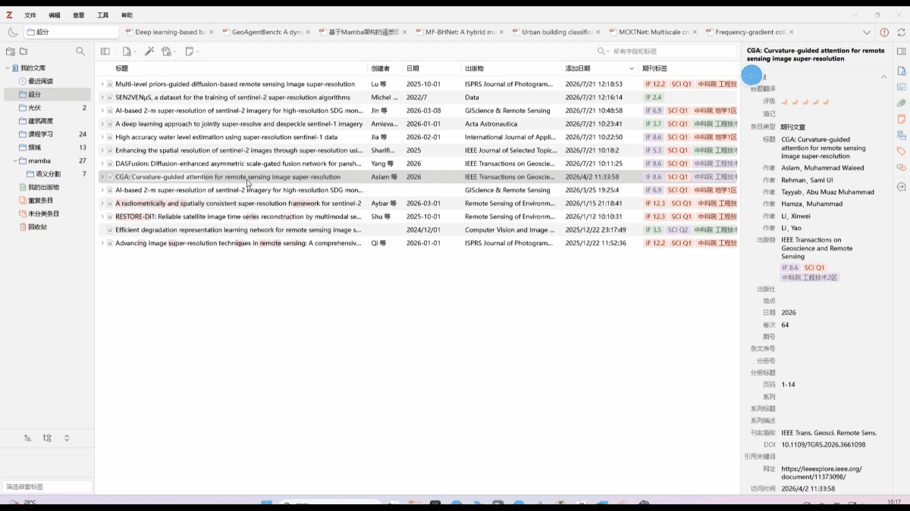
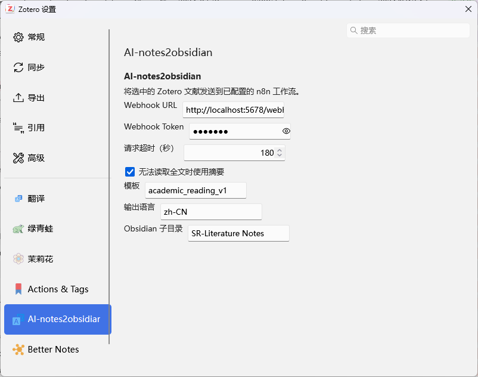
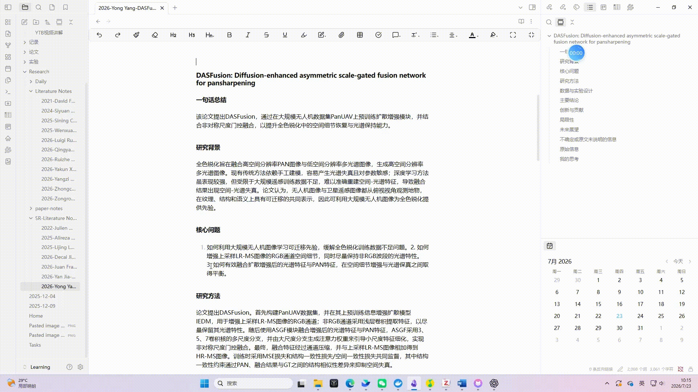
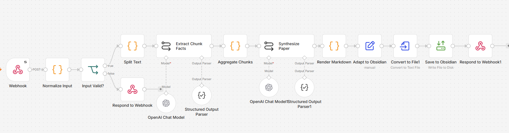

# Zotero AI Notes

将 Zotero 9 中选中的文献全文或摘要发送到 n8n AI 阅读工作流，并由工作流生成 Obsidian 笔记。

[](https://www.zotero.org/)
[](https://github.com/luelue-dot/Zotero-AI-Notes/releases)
[](LICENSE)
[](https://github.com/windingwind/zotero-plugin-template)

当前版本：**3.1.8**

## 功能

- 适配 Zotero 9.0–9.\*。
- 在文献条目右键菜单中提供 `AI-notes2obsidian`。
- 读取 Zotero PDF 全文索引缓存；全文不可用时可降级使用摘要。
- 将文献元数据、全文/摘要和输出选项以单次 JSON POST 发送到 n8n。
- 使用 Zotero 原生 HTTP 接口，不上传原始 PDF 文件。
- 对配置、全文、网络、超时、HTTP 和响应错误提供明确提示。
- 插件不直接写入 Obsidian，笔记生成和保存由 n8n 工作流完成。

## 功能展示

### Zotero 右键菜单



### 插件设置



### 处理结果



## n8n 工作流



仓库已提供可直接导入的工作流文件：

[`zotero-ai-reading.json`](./zotero-ai-reading.json)

该工作流包含 17 个节点，主要流程为：

1. 接收并校验 Zotero 插件请求。
2. 规范化输入并将长文本拆分为多个片段。
3. 使用 OpenAI 模型提取各片段信息。
4. 汇总全文并生成结构化论文笔记。
5. 渲染 Markdown，转换文件并写入 Obsidian。
6. 向插件返回成功路径或明确的错误信息。

工作流文件不包含 Webhook Token 或 OpenAI API Key，但保留了导出时的凭据引用。导入后需要在自己的 n8n 实例中重新选择：

- Webhook 节点的 Header Auth 凭据；请求头名称应为 `X-Workflow-Token`，值应与插件设置中的 Token 相同。
- 两个 OpenAI Chat Model 节点使用的 OpenAI 凭据；如果当前实例不支持工作流预设模型，请改为自己可用的模型。
- `Save to Obsidian` 节点写入 `/files/`，因此 n8n 运行环境需要把自己的 Obsidian Vault 映射或挂载到 `/files/`。

n8n Webhook 节点至少需要满足：

- HTTP Method：`POST`
- Path：`zotero-ai-reading`
- 工作流状态：Published/Active
- 生产地址示例：`http://localhost:5678/webhook/zotero-ai-reading`

工作流成功时应返回 JSON：

```json
{
  "success": true,
  "relativePath": "Literature Notes/example.md"
}
```

## 安装与部署

### 1. 安装插件

1. 从 [Releases](https://github.com/luelue-dot/Zotero-AI-Notes/releases) 下载 `zotero-ai-reading.xpi`。
2. 在 Zotero 中打开“工具 → 插件”。
3. 点击右上角齿轮，选择“Install Plugin From File...”。
4. 选择 XPI，安装后完全退出并重新启动 Zotero。

### 2. 准备 n8n

1. 下载仓库中的 [`zotero-ai-reading.json`](./zotero-ai-reading.json)。
2. 在 n8n 中选择 Import from File 并导入该文件。
3. 为 Webhook 和两个 OpenAI Chat Model 节点重新选择自己的凭据。
4. 确认 `/files/` 已映射到自己的 Obsidian Vault。
5. 确认 Webhook 节点使用 `POST` 和路径 `zotero-ai-reading`。
6. 发布/激活工作流。

### 3. 配置插件

在 Zotero 的插件设置中打开 `AI-notes2obsidian`，填写：

- Webhook URL
- Webhook Token
- 请求超时时间
- 输出模板和语言
- Obsidian 子目录

### 4. 使用

选择一篇父级普通文献条目，右键点击 `AI-notes2obsidian`。第一版仅支持单选，不要直接选择 PDF 附件、笔记或批注。

## 常见问题

如果出现：

```text
The requested webhook "POST zotero-ai-reading" is not registered
```

说明请求已经到达 n8n，但工作流尚未注册对应 Webhook。请检查工作流是否已发布、HTTP Method 是否为 `POST`、Path 是否为 `zotero-ai-reading`。

## 作者与许可

- Author: [luelue-dot](https://github.com/luelue-dot)
- License: [AGPL-3.0-or-later](LICENSE)
